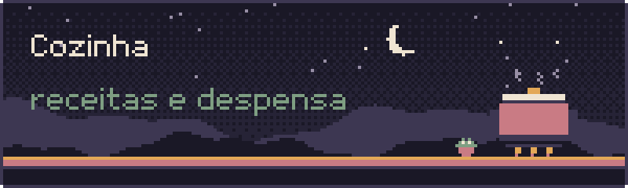
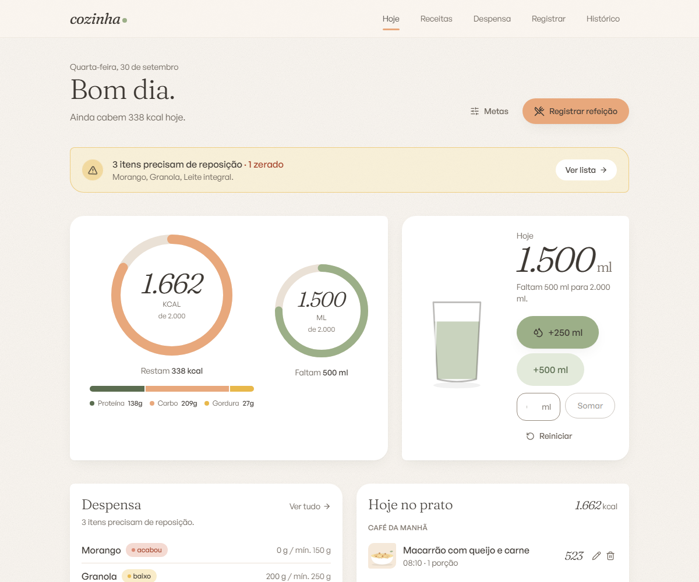
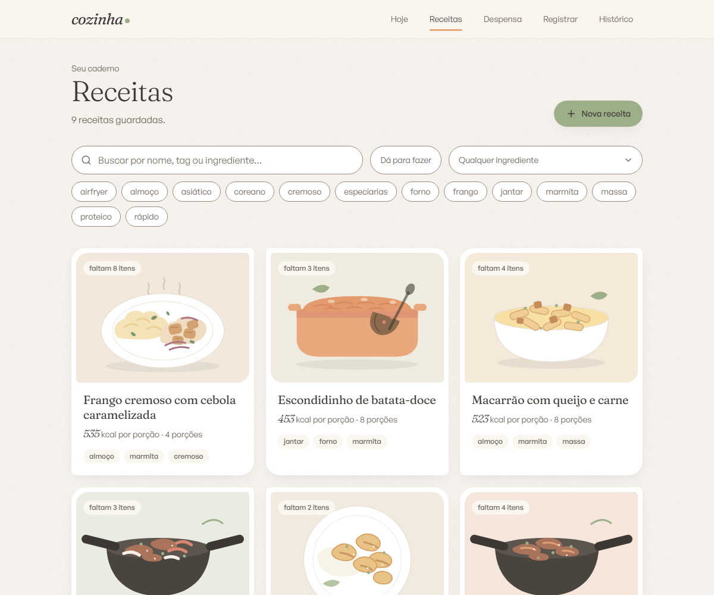
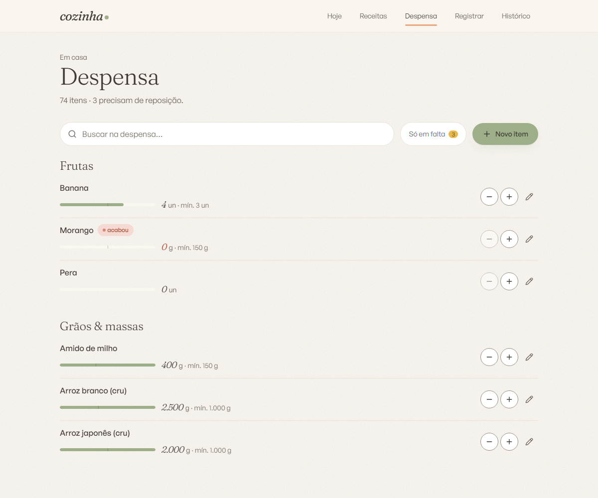
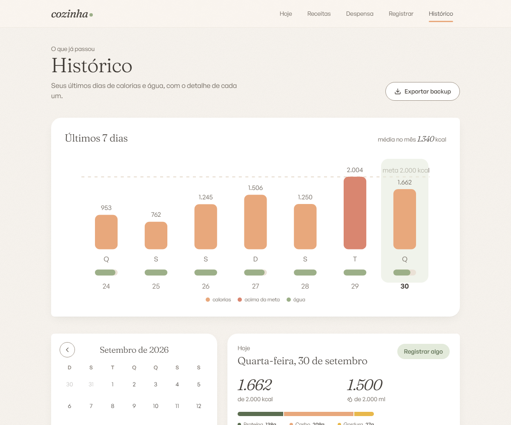

<p align="center">
  
</p>

<p align="center">
  <b>Receitas, calorias, água e despensa no mesmo lugar.</b><br>
  Um app pessoal de cozinha: você registra o que comeu e o estoque da despensa acompanha sozinho.
</p>

<p align="center">
  <a href="#como-rodar">Como rodar</a> ·
  <a href="docs/README.md">Documentação</a> ·
  <a href="docs/regras-de-negocio.md">Regras de negócio</a> ·
  <a href="https://eduardohenrique-nu.vercel.app">Portfólio</a>
</p>

<p align="center"></p>

<p align="center">
  
  
</p>
<p align="center">
  
  
</p>

<p align="center"><sub>As capturas usam as receitas de exemplo do próprio projeto e registros de demonstração.</sub></p>

## O que é

Quatro coisas que costumam viver em apps separados, ligadas entre si:

- **Receitas** com foto, porções, tags e modo de preparo. As calorias e os macros saem dos ingredientes, não de um número digitado.
- **Consumo**: registrar uma receita (em porções), um item da despensa (em gramas, mililitros ou unidades) ou um alimento avulso, só com as calorias.
- **Água**: botões rápidos de +250 ml e +500 ml, um campo para outro valor e o desfazer de cada registro.
- **Despensa** com estoque atual e mínimo de cada ingrediente e alerta de estoque baixo.

O ponto central é a ligação entre eles. Ao registrar uma receita, o app calcula as calorias pelos ingredientes, **desconta do estoque** a parte proporcional às porções e avisa se algum item ficou no mínimo. Se você apagar o registro, o estoque volta.

### Alguns detalhes

- **O histórico não muda com as receitas.** Cada registro guarda uma cópia do que foi comido (nome, calorias, macros e foto). Editar ou apagar uma receita depois não altera os dias que já passaram.
- **"Dá para fazer".** Um filtro mostra só as receitas que cabem no que há na despensa, e cada cartão diz quantas porções dá para preparar ou quantos ingredientes faltam.
- **Busca de alimentos opcional.** No cadastro de ingrediente, dá para preencher as calorias e os macros pela [Open Food Facts](https://world.openfoodfacts.org), por nome ou por código de barras. Se a API não responder, o formulário segue à mão.
- **Backup em um clique.** O histórico exporta tudo em um JSON legível.
- **Instalável no celular** (PWA), com atalhos para registrar refeição, água e abrir a despensa.

## Como rodar

Precisa de Node.js 20 ou mais novo.

```bash
git clone https://github.com/eduardohenrique-dev/cozinha.git
cd cozinha

npm install
cp .env.example .env
npm run db:push
npm run db:seed
```

O app usa duas famílias de fonte que **não vêm no repositório**: Fraunces (Google Fonts) e General Sans (Fontshare). Antes de subir o servidor, baixe os quatro arquivos e coloque em `src/app/fonts/`. A lista exata e os links estão em [instalação](docs/instalacao.md#fontes), e o comando abaixo avisa o que falta:

```bash
npm run dev
```

O app abre em <http://localhost:3000>. O `db:seed` cria 74 ingredientes e 9 receitas de exemplo, então dá para explorar tudo logo de cara.

## Stack

| Camada | Tecnologia |
| --- | --- |
| Framework | Next.js 14 (App Router) e TypeScript |
| Banco | SQLite, pelo Prisma 6 |
| Validação | zod, nos formulários (react-hook-form) e nas Server Actions |
| Estilo | Tailwind CSS 3 com tema fechado, só com os tokens do projeto |
| Animação | GSAP e ScrollTrigger |
| Estado | Zustand, só para o resumo do dia |
| Imagens | sharp, com upload convertido para WebP e miniatura |
| Datas | date-fns em pt-BR |

## Como é por dentro

```
prisma/
  schema.prisma      modelos do banco
  seed.ts            ingredientes e receitas de exemplo
src/
  app/               rotas, Server Actions por módulo e Route Handlers
  components/        interface, organizada por módulo (receitas, despensa, registro…)
  lib/               regras puras e acesso aos dados (nutrição, estoque, dia, histórico)
  store/             estado leve do dia
scripts/             verificação das fontes
```

As regras de negócio ficam em `src/lib/`, separadas da interface, e cada Server Action revalida a entrada com o mesmo schema zod usado no formulário. A visão completa está em [arquitetura](docs/arquitetura.md).

## Documentação

- [Instalação](docs/instalacao.md)
- [Guia de uso](docs/guia-de-uso.md)
- [Arquitetura](docs/arquitetura.md)
- [Modelo de dados](docs/modelo-de-dados.md)
- [Regras de negócio](docs/regras-de-negocio.md)
- [Rotas e ações](docs/rotas-e-acoes.md)
- [Design](docs/design.md)
- [Decisões de projeto](docs/decisoes.md)

---

<sub>Feito em Governador Valadares (MG). Código publicado para consulta; todos os direitos reservados.</sub>
