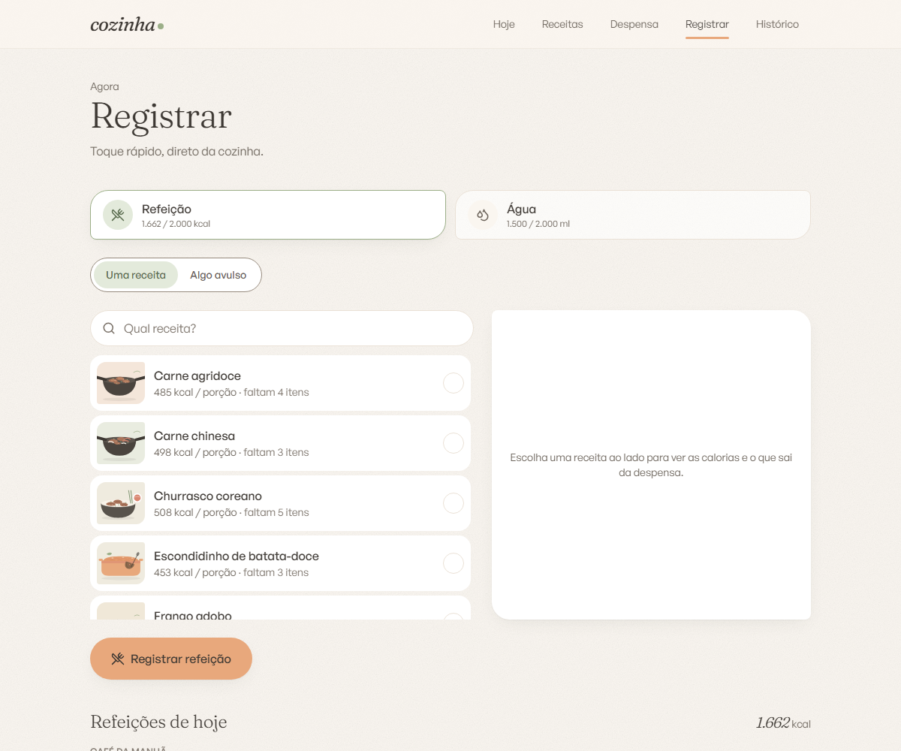

# Guia de uso

O app tem cinco telas, na barra do topo: **Hoje**, **Receitas**, **Despensa**, **Registrar** e **Histórico**.

## Hoje

O resumo do dia. De cima para baixo:

- **Saudação e saldo**: quantas calorias ainda cabem na meta do dia.
- **Aviso de reposição**: aparece quando algum ingrediente monitorado está no estoque mínimo ou abaixo dele, com o número de itens e quantos já zeraram. O botão leva à despensa já filtrada.
- **Anéis**: calorias (com a distribuição de proteína, carboidrato e gordura logo abaixo) e água, cada um contra a sua meta.
- **Água**: um copo que enche, os botões de +250 ml e +500 ml, um campo para outra quantidade e o botão de reiniciar o dia.
- **Despensa e "Hoje no prato"**: os itens que pedem reposição e a lista do que foi comido, agrupada por período do dia (café da manhã até 11h, almoço até 15h, lanche até 18h e jantar depois disso). Cada item tem ícones para editar a quantidade e apagar.

O botão **Metas** define a meta de calorias e a de água por dia.

## Receitas

O caderno de receitas.

- **Busca** por nome, tag ou ingrediente.
- **Filtros**: por tag, por um ingrediente específico e **Dá para fazer**, que mostra só as receitas que cabem no estoque atual.
- **Cartão**: foto, calorias por porção, número de porções e tags. Um selo diz quantos ingredientes faltam; sem faltas, o cartão indica quantas porções dá para preparar.

Dentro de uma receita estão as calorias e os macros por porção, a lista de ingredientes (com a quantidade para a receita inteira e o estoque atual de cada um, com um selo de "pouco" ou "em falta") e o modo de preparo em passos numerados. De lá, **Registrar consumo** leva à tela de registro com a receita já escolhida.

### Criar e editar

**Nova receita** abre o formulário:

| Campo | Observação |
| --- | --- |
| Nome da receita | obrigatório, até 120 caracteres |
| Foto | arraste ou escolha um arquivo; o app converte para WebP e cria uma miniatura |
| Porções | de 1 a 100; é o rendimento da receita inteira |
| Tags | livres, para filtrar depois |
| Ingredientes | pelo menos um, sem repetição. A quantidade é **para a receita inteira**, na unidade do ingrediente |
| Modo de preparo | um passo por linha; cada linha vira um passo numerado |

As calorias e os macros aparecem calculados a partir dos ingredientes, e mudam conforme você ajusta as quantidades.

## Despensa

O estoque, agrupado por categoria.

- **Buscar na despensa** filtra a lista, e o atalho **Só em falta** mostra apenas os itens com estoque baixo.
- Cada item mostra o estoque atual e o mínimo, uma barra de nível e um selo: **baixo** quando o estoque chegou ao mínimo e **acabou** quando zerou.
- Os botões de mais e menos ajustam o estoque sem abrir o item, num passo que depende da unidade. Ele nunca fica negativo. Ao cruzar o mínimo para baixo, o app avisa.

### Cadastrar um ingrediente

| Campo | Observação |
| --- | --- |
| Nome e categoria | a categoria organiza a lista; dá para criar uma nova |
| Unidade | `g`, `ml` ou `un` |
| Peso de uma unidade | obrigatório só para `un`: quantos gramas pesa uma unidade (um ovo, por exemplo, cerca de 50 g) |
| Calorias, proteína, carboidrato e gordura | sempre **por 100 g ou 100 ml** |
| Estoque atual e mínimo | na unidade do ingrediente |

O botão **Buscar** preenche os valores nutricionais a partir da base do Open Food Facts, por nome ou por código de barras. Se a busca não responder, preencha à mão.

> **Estoque mínimo 0 significa "não monitorado".** Itens com mínimo 0 nunca geram alerta. É útil para o que você não controla, como sal e água.

### Excluir um ingrediente

Você pode apagar qualquer item, mesmo que ele esteja em receitas. Antes de confirmar, o app lista **quais receitas serão afetadas**. Elas continuam existindo e passam a ser calculadas sem aquele ingrediente. A ideia é que a despensa reflita o que você tem, e não o que as receitas pedem.

## Registrar

Duas abas, cada uma com o resumo do dia no topo.

### Refeição

- **Uma receita**: escolha a receita e quantas porções comeu, de meia em meia porção (de 0,5 a 20). O app calcula as calorias e os macros, grava o registro e desconta os ingredientes do estoque na proporção.
- **Algo avulso**: escolha um **item da despensa** e a quantidade (o estoque é descontado), ou digite um nome e as calorias para algo que não está cadastrado, como um lanche da padaria (nada é descontado).

Ao registrar, se algum ingrediente chegar ao mínimo, o app avisa na hora.

### Água

Os mesmos botões da tela Hoje, mais a lista dos copos registrados no dia, cada um com a opção de apagar.

## Histórico

- **Últimos 7 dias**: um gráfico de barras das calorias contra a meta, com a água de cada dia. Ele é desenhado em SVG, sem biblioteca de gráficos.
- **Calendário do mês**: navegável, com os dias que têm registro marcados. Escolha um dia para ver o detalhe.
- **Detalhe do dia**: calorias, água, macros e a lista do que foi comido.
- **Exportar**: baixa o backup completo em JSON.

**Só o dia de hoje pode ser editado ou apagado.** Os dias anteriores ficam em modo de leitura, para o histórico não ser reescrito sem querer.

## Instalar no celular

O app tem um manifesto de PWA. No navegador do celular, use "Adicionar à tela inicial". O ícone abre o app em tela cheia, com atalhos para **Registrar refeição**, **Água** e **Despensa**.
